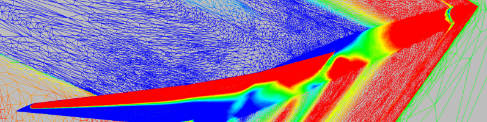

# Sonic Boom Prediction Working Group

## Important Note

The entire lbpw.larc.nasa.gov site is currently being migrated to **GitHub**; the original NASA Langley URL will shortly redirect to this site.

## Purpose

This site provides a centralized location for the dissemination of information and data supporting ongoing research in sonic boom prediction.

## Archived

- ASA Focus Boom (2022)
- 3rd Workshop (2020)
- 2nd Workshop (2017)
- [1st Workshop (2014)](/sbpw1/)

## References

- [2019 AIAA AVIATION Special Sessions](references/2019-aviation/)
- [SBPW2 AIAA Journal of Aircraft Special Section](references/sbpw2-aiaaja/)
- [2017 AIAA AVIATION Special Sessions](references/2017-aviation/)
- [2017 AIAA SciTech Special Sessions](references/2017-scitech/)
- [2016 AIAA AVIATION Special Sessions](references/2016-aviation/)
- [2016 AIAA SciTech Special Sessions](references/2016-scitech/)
- [2015 AIAA AVIATION Special Sessions](references/2015-aviation/)
- [2015 AIAA SciTech Special Sessions](references/2015-scitech/)
- [2014 AIAA AVIATION Special Sessions](/sbpw1/references/2014-aviation/)
- [2014 1st AIAA Sonic Boom Workshop Related Publications](/sbpw1/references/)
- [ASM 2013 Special Session](references/asm-2013-special-session/)
- [2008 NASA Boom Workshop](references/2008-nasa-fap-boom-workshop/)

---
***Page Curators:*** [Mathias Wintzer](mailto:mathias.wintzer@nasa.gov), [Alexandra Loubeau](mailto:a.loubeau@nasa.gov)\
***Last Updated:*** Oct 21, 2026
