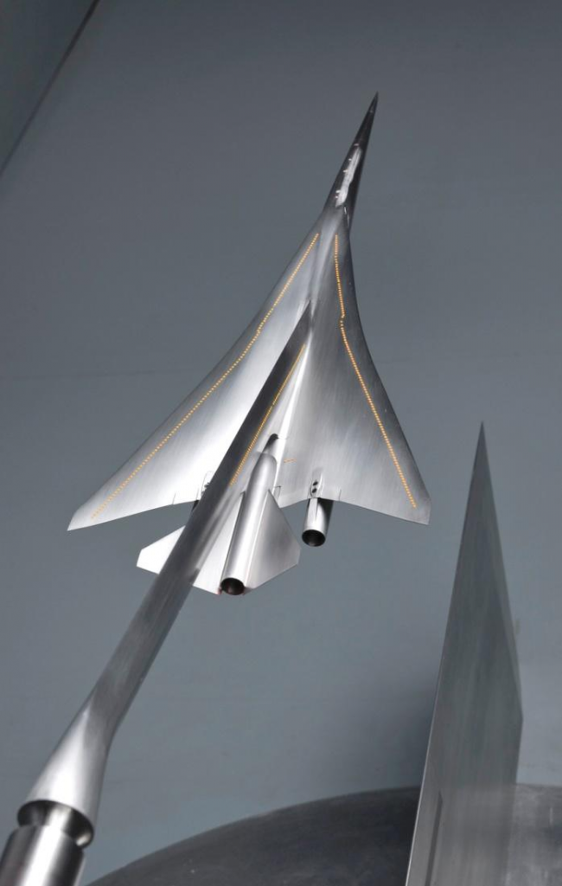

# 1st Sonic Boom Prediction Workshop (2014)

The objective of the First Sonic Boom Prediction Workshop is to assess the state of the art for predicting signatures suitable for sonic boom propagation. To be suitable, a flow solution must be accurate sufficiently far from the vehicle to avoid near-field interference. Comparisons will be made between participant solutions on workshop provided grids. Participants are requested to apply their best practices for computing solutions on the provided geometries. There is particular interest in exploring refinement techniques including grid adaptation and alignment with flow characteristics. Impartial comparisons will be made between different solution schemes as well as with wind tunnel validation data for assessing the state of the art and identifying areas requiring additional research and further development.

The agenda for the workshop is available as [Final Agenda](SBPW1_final_agenda.pdf). The [Workshop Presentations](https://lbpw-ftp.larc.nasa.gov/lbpw1/presentations/) (including introduction and summary) from the first workshop are available on the HTTPS server. The template used for the participant presentation is available as [Presentation Guidelines](SBPW1_Presentation_Guidelines.pdf).

 

[Test Cases for the 2014 First AIAA Sonic Boom Workshop](test_cases/index.md)

[Participant submitted data and derived analysis](https://lbpw-ftp.larc.nasa.gov/lbpw1/workshop/)

[References related to the 2014 First AIAA Sonic Boom Workshop](references/README.md)

[SBPW 1 Flyer](SBPW_1_Flyer.pdf)

- July 15, 2013: Acceptance Notification sent by committee
- November 7, 2013 ~October 31, 2013~: Participant data submittal deadline
- [Registration for workshop is through the AIAA](http://www.aiaa.org/EventDetail.aspx?id=4716)
- **January 11, 2014: 1st Low Boom Prediction Workshop**

---

***Return to:*** [Sonic Boom Prediction Working Group Home Page](https://sbpwg.github.io)

---
***Page Curators:*** [Mathias Wintzer](mailto:mathias.wintzer@nasa.gov)  
***Last Updated:*** Mar 7, 2019
